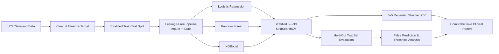

# Healthy Artery: Heart Disease Prediction & Risk Stratification System

**Healthy Artery** is a production-grade, offline machine learning classification pipeline designed to assess cardiovascular disease risk using clinical indicators from the UCI Cleveland Heart Disease dataset.

The system rigorously implements leakage-free preprocessing, trains and tunes three distinct classification paradigms (Logistic Regression, Random Forest, and XGBoost), benchmarks them with 5x5 repeated cross-validation, and performs deep false-prediction and clinical trade-off analysis.

---

## Architecture Overview



---

## Key Features

- **No Data Leakage:** All preprocessing (median imputation and standard scaling) is contained within scikit-learn `Pipeline` objects, ensuring zero information spills between folds or splits.
- **Model Diversity:**
  - **Logistic Regression (Baseline):** Interpretable linear model with standardized coefficients and odds ratios.
  - **Random Forest:** Bagged ensemble capable of capturing non-linear interactions without feature scaling.
  - **XGBoost:** Regularized gradient boosted decision trees optimized for high precision and recall.
- **Statistical Rigor:** Evaluated using both a held-out test split (20%) and Repeated Stratified 5x5 Cross-Validation (25 folds) with means and standard deviations.
- **Clinical Error Profiling:** Detailed exploration of False Negatives vs. True Positives, multi-model consensus, threshold sweeping, SHAP value explanations, and subgroup disparity checks (sex and age).
- **Core vs. Extension Experiments:** Directly compares a 5-feature continuous physiological model vs. a 13-feature comprehensive clinical model.

---

## Directory Layout

```
heart_disease_prediction/
├── data/
│   ├── raw/
│   │   └── processed.cleveland.data    # Original UCI Cleveland dataset (303 rows)
│   └── processed/                      # Processed caches
├── models/
│   ├── logistic.joblib                 # Tuned core Logistic Regression
│   ├── random_forest.joblib            # Tuned core Random Forest
│   ├── xgboost.joblib                  # Tuned core XGBoost
│   ├── ext_logistic.joblib             # Tuned 13-feature Logistic Regression
│   ├── ext_random_forest.joblib        # Tuned 13-feature Random Forest
│   └── ext_xgboost.joblib              # Tuned 13-feature XGBoost
├── notebooks/
│   ├── 01_eda.ipynb                    # Exploratory Data Analysis & visual inspections
│   ├── 02_modeling.ipynb               # Model training, hyperparameter tuning & evaluation
│   └── 03_errors.ipynb                 # False prediction analysis, SHAP, and threshold sweep
├── reports/
│   ├── figures/
│   │   ├── class_balance.png           # Target prevalence
│   │   ├── numeric_distributions.png   # Continuous feature histograms
│   │   ├── correlation_heatmap.png     # Feature correlation matrix
│   │   ├── outlier_boxplots.png        # Outlier identification
│   │   ├── confusion_matrices.png      # TN / FP / FN / TP per model
│   │   ├── roc_pr_curves.png           # ROC and PR curves
│   │   ├── threshold_sweep.png         # Recall vs Precision trade-offs
│   │   ├── calibration_curves.png      # Probability reliability
│   │   ├── shap_summary_xgb.png        # SHAP feature attributions
│   │   └── core_vs_extension.png       # 5-feature vs 13-feature comparison
│   ├── test_errors.csv                 # Granular record of misclassified test patients
│   └── report.md                       # Full clinical findings & scientific report
├── scripts/
│   ├── download_data.py                # Dataset fetcher
│   ├── run_eda.py                      # Headless EDA execution
│   ├── plot_roc_pr.py                  # ROC/PR curve generator
│   ├── run_error_analysis.py           # Comprehensive error analysis pipeline
│   └── compare_experiments.py          # Core vs Extension benchmark script
├── src/
│   ├── __init__.py                     # Package initialization
│   ├── config.py                       # Seeds, paths, feature subsets, column maps
│   ├── data.py                         # Data ingestion, missing value markers, target binarization
│   ├── preprocess.py                   # Stratified split, pipeline transformers
│   ├── models.py                       # Model pipelines and GridSearchCV parameter grids
│   ├── train.py                        # Training & persistence entry point
│   ├── evaluate.py                     # Evaluation metrics and 5x5 repeated CV
│   └── errors.py                       # False prediction extraction, profiling & calibration
├── architecture.md                     # System architecture specification
├── buildme.md                          # Step-by-step build instructions
├── requirements.txt                    # Python dependencies
└── README.md                           # Project documentation
```

---

## Installation & Setup

### 1. Prerequisites
- Python 3.10+ (Tested on Python 3.13)
- `pip` package manager

### 2. Environment Setup
```bash
# Clone or navigate to the workspace
cd heart_disease_prediction

# Create and activate virtual environment (optional)
python -m venv .venv
# On Windows:
.venv\Scripts\activate
# On Linux/macOS:
source .venv/bin/activate

# Install dependencies
pip install -r requirements.txt
```

### 3. Fetch Dataset
If the data file is not already present:
```bash
python scripts/download_data.py
```

---

## Execution Guide

### Step 1: Run Exploratory Data Analysis
```bash
python scripts/run_eda.py
```
Outputs distribution summaries and saves visualization charts into `reports/figures/`.

### Step 2: Train Core Models (5 Continuous Physiological Features)
```bash
python -m src.train --features core
```
Fits GridSearchCV over Stratified 5-Fold CV and serializes the best estimators to `models/`.

### Step 3: Evaluate Models & Run 5x5 Repeated Cross-Validation
```bash
python -m src.evaluate --features core
```
Prints the held-out test metrics and full 5x5 repeated cross-validation mean $\pm$ standard deviation table.

### Step 4: Run False Prediction & Clinical Error Analysis
```bash
python scripts/run_error_analysis.py
```
Generates confusion matrices, calculates multi-model consensus, profiles missed disease cases (FN), performs threshold sweeps, and produces SHAP feature attributions.

### Step 5: Run Extension Experiment (All 13 Clinical Attributes)
```bash
python -m src.train --features all
python scripts/compare_experiments.py
```
Compares the 5-feature constraint against the full 13-feature clinical model, saving `reports/figures/core_vs_extension.png`.

### Step 6: Launch Desktop GUI Application
```bash
python app.py
```
Launches the interactive CustomTkinter desktop interface featuring real-time input validation, risk classification, Light/Dark appearance modes, and a Model Comparison tab with metrics and chart viewing.

---

## Summary of Results

### Core (5 Continuous Features: age, trestbps, chol, thalach, oldpeak)
- **Held-Out Test Set (20%):**
  - **XGBoost:** ROC-AUC: **0.902**, Recall: **82.1%**, Precision: **88.5%**, Accuracy: **86.9%** (5 FN, 3 FP).
  - **Random Forest:** ROC-AUC: **0.897**, Recall: **82.1%**, Precision: **88.5%**, Accuracy: **86.9%** (5 FN, 3 FP).
  - **Logistic Regression:** ROC-AUC: **0.873**, Recall: **78.6%**, Precision: **81.5%**, Accuracy: **82.0%** (6 FN, 5 FP).
- **5x5 Repeated Stratified CV:**
  - **Logistic Regression:** ROC-AUC: $0.788 \pm 0.037$, Recall: $0.577 \pm 0.081$, F1: $0.651 \pm 0.058$.
  - **Random Forest:** ROC-AUC: $0.786 \pm 0.039$, Recall: $0.636 \pm 0.083$, F1: $0.683 \pm 0.064$.
  - **XGBoost:** ROC-AUC: $0.784 \pm 0.043$, Recall: $0.625 \pm 0.078$, F1: $0.686 \pm 0.061$.

### Extension (All 13 Clinical Attributes)
- **Random Forest (13 features):** Test ROC-AUC: **0.965**, Recall: **92.9%**, Precision: **89.7%**, Accuracy: **91.8%** (Only 2 FN, 3 FP). Repeated CV ROC-AUC: **$0.912 \pm 0.034$**.
- **Diagnostic Cost of 5-Feature Constraint:** Excluding categorical symptoms and fluoroscopy findings reduces Repeated CV ROC-AUC by **$\sim 12.6\%$** and recall by **$\sim 16-21\%$**.

### Threshold Recommendation
- Lowering the decision threshold from $\tau = 0.50$ to $\tau = 0.35$ reduces False Negatives from **5 to 2** (a **$60\%$ reduction in missed cardiac disease**), costing only 3 additional False Positives. For clinical screening, $\tau = 0.35$ is strongly recommended.

---

## Comprehensive Report

Read the detailed clinical findings, subgroup analyses, and biological discussions in [reports/report.md](reports/report.md).

---

## Disclaimer

> [!WARNING]
> **Healthy Artery** is an educational and research machine learning demonstration. It has not been validated in prospective clinical trials, evaluated by the FDA, or CE-marked as a medical device. It must **not** be used as a standalone diagnostic tool or to direct clinical treatment.

