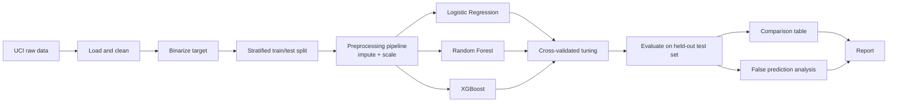
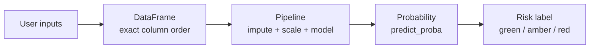
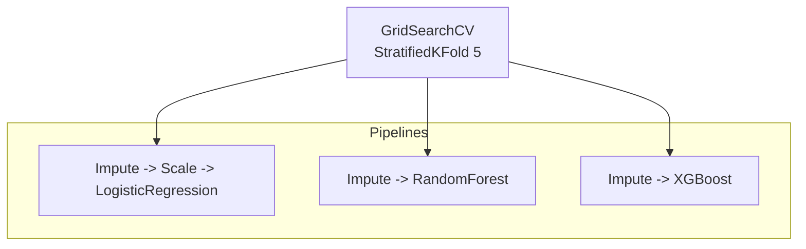
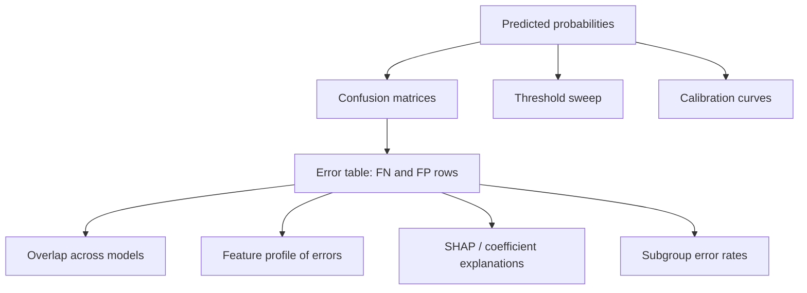

# ARCHITECTURE: Heart Disease Prediction System

This document describes how the system is organized, how data flows through it, and why key design choices were made.

## 1. Overview

The system is an offline machine learning pipeline, not a web service. It ingests the UCI Heart Disease dataset, trains three classifiers on numeric features, compares them under identical conditions, and analyzes their false predictions.

**Models:** Logistic Regression (baseline), Random Forest, XGBoost.

## 2. High-Level Data Flow

### Pipeline Training & Evaluation Flow


### Desktop App Inference Data Flow


## 3. Component Layers

| Layer | Module | Responsibility |
|---|---|---|
| Configuration | `src/config.py` | Seeds, split sizes, feature lists, paths |
| Data | `src/data.py` | Load raw file, handle missing markers, binarize target |
| Preprocessing | `src/preprocess.py` | Train/test split, imputer and scaler steps |
| Models | `src/models.py` | Pipelines and hyperparameter grids for each model |
| Training | `src/train.py` | Cross-validated tuning, model persistence |
| Evaluation | `src/evaluate.py` | Metrics and comparison table |
| Error analysis | `src/errors.py` | FN/FP extraction, thresholds, calibration, SHAP |
| Prediction Service | `src/predict.py` | Model caching, input validation, risk categorization |
| Presentation / GUI | `app.py` | CustomTkinter desktop UI, theme control, chart browser |
| Reporting | `reports/` | Figures and final write-up |

Each layer depends only on layers above it in this table. Nothing in `data` or `preprocess` knows about specific models.

## 4. Project Layout

```
heart-disease-prediction/
  app.py                  CustomTkinter desktop GUI application
  data/
    raw/                  original UCI file, never modified
    processed/            cleaned data (optional cache)
  notebooks/
    01_eda.ipynb
    02_modeling.ipynb
    03_errors.ipynb
  src/
    config.py
    data.py
    preprocess.py
    models.py
    train.py
    evaluate.py
    errors.py
    predict.py            prediction & validation service
  models/                 saved .joblib files
  reports/
    figures/
    report.md
  requirements.txt
  README.md
  buildme.md
  architecture.md
```

## 5. Data Architecture

**Input:** 13 attributes plus one target column (`num`, values 0 to 4).

**Feature sets:**

- **Core (5 continuous):** `age`, `trestbps`, `chol`, `thalach`, `oldpeak`
- **Extended (all numeric-coded):** core plus `sex`, `cp`, `fbs`, `restecg`, `exang`, `slope`, `ca`, `thal`

**Target:** `target = 1` if `num > 0`, else `0`.

**Cleaning rules:**

- `?` becomes NaN
- `chol == 0` and `trestbps == 0` become NaN (physiologically impossible)
- Exact duplicate rows are dropped

## 6. Preprocessing and Leakage Control

All preprocessing lives inside scikit-learn `Pipeline` objects. This guarantees that during cross-validation the imputer and scaler are refit on each training fold only, so no test or validation information leaks in.

| Model | Imputer | Scaler | Reason |
|---|---|---|---|
| Logistic Regression | median | StandardScaler | Regularized linear model is scale-sensitive |
| Random Forest | median | none | Tree splits are scale-invariant |
| XGBoost | median | none | Tree splits are scale-invariant |

## 7. Model Layer



| Model | Role | Key hyperparameters tuned | Interpretability |
|---|---|---|---|
| Logistic Regression | Baseline | `C` | Coefficients and odds ratios |
| Random Forest | Bagged trees | `n_estimators`, `max_depth`, `min_samples_leaf`, `max_features` | Feature importance, SHAP |
| XGBoost | Boosted trees | `n_estimators`, `learning_rate`, `max_depth`, `subsample`, `colsample_bytree`, `reg_lambda` | Feature importance, SHAP |

All three share the same seed, the same split and the same CV folds, so differences in results reflect the models and not the setup.

## 8. Evaluation Architecture

Two evaluation views are produced:

1. **Held-out test set:** a single stratified 20% split for final confusion matrices and curves.
2. **Repeated stratified k-fold (5x5):** mean and standard deviation of each metric, because roughly 300 rows make a single split unreliable.

**Metrics:** accuracy, precision, recall, specificity, F1, ROC-AUC, PR-AUC, Brier score, and TN/FP/FN/TP counts.

**Primary decision metric:** recall on the disease class, with FN count reported prominently.

## 9. False Prediction Analysis Module



| Analysis | Question it answers |
|---|---|
| Confusion matrix | How many FN and FP does each model make |
| Threshold sweep | What does lowering the cutoff cost in extra FPs |
| Overlap | Which patients are hard for every model |
| Feature profile | Do errors cluster in certain value ranges |
| SHAP / coefficients | Why was the model confidently wrong |
| Calibration | Are the predicted probabilities trustworthy |
| Subgroups | Is any group (sex, age band) served worse |

## 10. Design Decisions

| Decision | Choice | Rationale |
|---|---|---|
| Baseline first | Logistic Regression | Sets a bar complex models must clearly beat |
| Pipelines everywhere | scikit-learn `Pipeline` | Prevents data leakage |
| Binary target | `num > 0` | Standard framing; small counts for classes 2 to 4 |
| Recall-focused | FN is costlier than FP | Missing disease is the more harmful error |
| Repeated CV | 5x5 | Small data makes single splits noisy |
| Median imputation | Training-fold median | Robust to outliers |
| Fixed seeds | `RANDOM_STATE = 42` | Reproducibility |
| Offline artifacts | `.joblib` files | Simple persistence without serving infrastructure |

## 11. Technology Stack

| Purpose | Tool |
|---|---|
| Data handling | pandas, NumPy |
| Modeling | scikit-learn, XGBoost |
| Visualization | matplotlib, seaborn |
| Explainability | SHAP |
| Persistence | joblib |
| Experimentation | Jupyter |
| Desktop GUI | CustomTkinter |

## 12. Possible Future Extensions

- Add categorical features with one-hot encoding
- Try SVM, k-NN or a small neural network for comparison
- Add probability calibration (Platt scaling or isotonic regression)
- Combine the Cleveland, Hungary, Switzerland and VA subsets for more data
- Wrap the best model in a FastAPI service and a simple Streamlit form
- Track experiments with MLflow

## 13. Constraints and Limitations

- Small dataset (about 300 rows), so results have wide confidence intervals.
- Single-source, historical data may not generalize to other populations.
- Restricting to numeric features discards potentially useful information.
- Educational use only. The system is **not** a validated clinical tool and must not be used for real diagnosis.
